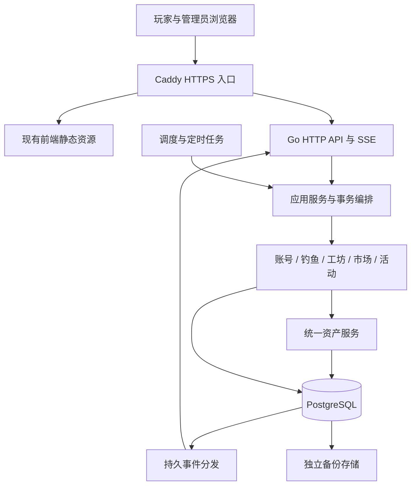

# 钓鱼游戏 Go 后端完整架构方案

> 文档版本：1.0 · 日期：2026-09-20
>
> 适用项目：web-fishing-game 及配套服务
>
> 技术路线：Go + PostgreSQL + 模块化单体，Linux 单机起步，按负载扩容
>
> 状态：供团队评审和实施使用的架构基线；尚未完成性能原型、正式服数据核查与恢复演练。
>
> 代码证据：本地 main，提交 `f98077d`。正式服实际版本需独立核对。

## 阅读说明与结论

本方案采用 Go 重写服务端，保留现有网页和玩法体验，通过数据库事务保证资产正确，通过模块边界支持长期开发，通过可恢复任务与分离部署支持后续多机运行。业务源码保持闭源，采用允许商业使用的开源基础组件。

第一阶段部署 Caddy、一个 Go 应用和一个 PostgreSQL 实例，同时配置独立存储上的备份。程序内部划分 HTTP、玩法、资产、调度、通知等模块；首期以 `all` 角色运行。API/worker 角色拆分属于后续扩展能力，实施时必须补齐协调与故障验证，不能假设改启动参数就自动获得多机能力。

本版落实了架构评审的七项修订：保留总体选型；提前验证高频钓鱼成本；补齐共享经济与定时任务一致性；明确 JavaScript 到 Go 的规则兼容；区分各类故障的数据承诺；简化首期调度与部署；将试迁移和性能原型前置。

文中三类表述须区分：

- **已确定**：用户已明确的需求及本方案采用的架构决策。
- **建议目标**：供实施验收使用的初始数值，需通过实测与业务确认，不是已达到的指标。
- **验证门槛**：达到对应条件后才能上线或启用该规模；缺少验证不能宣称已支持。

## 目录

1. [需求、范围与约束](#1-需求范围与约束)
2. [质量目标与验收口径](#2-质量目标与验收口径)
3. [现状与重构动机](#3-现状与重构动机)
4. [技术选型与商业许可](#4-技术选型与商业许可)
5. [总体结构与部署演进](#5-总体结构与部署演进)
6. [业务模块与扩展机制](#6-业务模块与扩展机制)
7. [代码组织与依赖规则](#7-代码组织与依赖规则)
8. [逻辑数据模型](#8-逻辑数据模型)
9. [事务并发与资产流水](#9-事务并发与资产流水)
10. [钓鱼调度随机与恢复](#10-钓鱼调度随机与恢复)
11. [共享世界配置与定时任务](#11-共享世界配置与定时任务)
12. [规则兼容与数据配置](#12-规则兼容与数据配置)
13. [HTTP、SSE 与前端契约](#13-httpsse-与前端契约)
14. [容量性能与存储预算](#14-容量性能与存储预算)
15. [安全与运营权限](#15-安全与运营权限)
16. [Linux 部署与发布](#16-linux-部署与发布)
17. [备份恢复与高可用](#17-备份恢复与高可用)
18. [可观测性与运行维护](#18-可观测性与运行维护)
19. [完整数据迁移与切换](#19-完整数据迁移与切换)
20. [测试与上线验收](#20-测试与上线验收)
21. [实施里程碑与协作](#21-实施里程碑与协作)
22. [架构决策与风险登记](#22-架构决策与风险登记)
23. [待确认事项与交付清单](#23-待确认事项与交付清单)
24. [依据与术语](#24-依据与术语)

## 1. 需求、范围与约束

### 1.1 已确认需求

| 项目 | 要求 |
|---|---|
| 产品范围 | 当前钓鱼游戏及配套服务，以 main 已实现功能为基线 |
| 商业模式 | 长期商业运营、维护和更新，业务代码闭源 |
| 后端路线 | 接受 Go 后端重写 |
| 初期规模 | 1～100 人；暂按同时在线理解 |
| 一年目标 | 1000～5000 人；同时钓鱼比例尚未确认 |
| 游戏世界 | 所有玩家共享世界、供需经济和市场 |
| 扩展需求 | 持续增加玩法、装备、活动、模块和外部业务 |
| 更新方式 | 可以重启，可以进行数分钟维护 |
| 数据要求 | 账号、背包、装备和市场等正式服数据完整迁移；不接受常规运行随意回退 |
| 团队 | 几位成员配合 AI 开发，暂缺 Go/Java 经验 |
| 硬件 | i9-14900KF、128GB 内存、150M 带宽；磁盘与实际公网条件待核对 |
| 部署 | Linux 单机起步，后续支持多服务器；当前不以基础设施费用限制方案 |

### 1.2 业务范围

覆盖身份认证、管理员 MFA、钓鱼及重连续钓、钓点与掉落、金币和背包、装备实例与钓竿槽位、工坊、商城及自动出售、市集、玩家交易、图鉴与纪录、社交展示与订阅、外观配置、反馈、通知、运营后台和功能开关。

配套 Wiki 等服务应依据各自实际版本独立盘点；不假定其他分支的功能或数据库已经存在于 main 或正式服。真实支付尚未确认，预留订单与对账边界，但不提前实现支付系统。

### 1.3 首期范围控制

首期采用编译式业务模块。新增鱼种、装备参数和简单活动优先走配置，新增机制通过 Go 模块实现。暂不建设任意脚本上传、动态二进制插件、跨区分服、数据库分片或 Kubernetes 平台。

前端继续使用当前网页技术，保留既有视觉与交互。Go 后端不要求更换游戏引擎；是否引入新的场景引擎、前端框架或 TypeScript，另行评估。

## 2. 质量目标与验收口径

### 2.1 数据正确性底线

1. 已回复成功的资产变更先完成数据库提交。
2. 同一业务操作重复提交不重复扣款、发奖或转移物品。
3. 一笔交易的相关账户、物品、税费和业务状态一起提交或一起回滚。
4. 装备实例同一时刻只有一个有效归属，不能同时被装备、交易和挂单消耗。
5. 同一钓鱼周期至多产生一次已提交的资产业务效果。
6. 客户端、缓存、通知系统和榜单都不能成为核心资产的唯一权威来源。
7. 失败、超时、重启与重连的结果可以查询或恢复，不以重新抽奖或盲目再次扣款解决不确定性。

### 2.2 性能与体验建议目标

以下作为原型和验收的初始目标，在明确机器、数据量和业务负载后冻结到压测清单中。

| 指标 | 建议目标 | 口径 |
|---|---|---|
| 普通读取 API | 服务端 p95 ≤ 200ms | 不包含公网往返；指定分页大小和数据规模 |
| 资产写操作 API | 服务端 p95 ≤ 300ms | 包含数据库提交；高冲突抢购独立报告 |
| 钓鱼调度延迟 | p95 ≤ max(100ms, 配置间隔的 10%) | 实际开始结算时间减应执行时间；100ms 玩法另设专门门槛 |
| 资产提交至通知发送 | p95 ≤ 500ms | 不包含客户端网络和后台挂起时间 |
| 稳态非预期错误 | 请求占比 < 0.1% | 验证失败、预期限流与售罄等业务结果单独统计 |
| 负载余量 | CPU、IO、连接池、带宽保留约 30% 峰值余量 | 连续运行无持续增长的积压，而非只看平均使用率 |
| 更新维护 | 初始目标 ≤ 5 分钟 | 包含升级和检查；迁移首发维护窗口以演练结果为准 |

p95 表示 95% 的样本不超过该值。不能用一次短压测或仅建立 5000 个连接替代持续玩法负载验证。

### 2.3 数据保护与故障目标

| 故障域 | 设计目标 | 限制与验证 |
|---|---|---|
| Go 进程崩溃 | 已提交成功的资产不回退；建议 2 分钟内恢复服务 | 数据库健康，客户端可能需要重连 |
| 数据库进程重启 | 已持久提交的数据恢复；暂停期间拒绝资产写入 | WAL、fsync、磁盘语义正确；实测恢复时间 |
| 单机磁盘或整机损坏 | 单机备份方案建议 RPO ≤ 5 分钟、RTO ≤ 2 小时 | 仅为待确认目标，不能视为满足用户的零回退要求；归档间隔及恢复演练决定能否达到 |
| 整机损坏仍要求 RPO=0 | 引入独立故障域同步副本，再确定切换方案 | 必须保证已确认提交已在同步副本持久化，并防止双主 |
| 业务 bug | 可按流水定向修复，必要时恢复到 bug 前 | 整库回退将撤销之后的正常操作，需有业务处理方案 |

RPO 是最多可丢失多久的数据，RTO 是恢复服务所需时间。正式上线前必须明确整机损坏的可接受承诺；单机异地备份不能宣传为整机故障零丢失。

## 3. 现状与重构动机

本地 main 使用 Node 内置 HTTP 与原生网页。玩家、会话、交易、钓鱼定时器和 SSE 连接保存在进程内存。账号与世界数据通过 JSON 文件保存，批量落盘最终仍执行同步写入。

| 已核查事实 | 架构影响 |
|---|---|
| 多个业务集中于 backend/server.js | 难以隔离修改范围和稳定模块接口 |
| 一笔购买分别保存买家、卖家、市集与经济文件 | 缺少跨文件原子提交，不能直接支撑多实例交易 |
| 钓鱼任务和在线状态保存在进程 Map 中 | 重启和多机后必须重新定义任务与连接归属 |
| frontend/js/data.js 被前后端共同使用 | Go 重写后必须建立配置和计算规则的一致来源 |
| 默认最短间隔 800ms，但配置及钓点固定间隔可达 100ms | 800ms 不能视为最坏容量边界 |
| 商店价格依赖全局供需，出售会修改供需状态 | 多节点必须统一定价与并发顺序 |
| 断线保留最后钓点，重连时续钓 | 不能在重写时自动变成无限离线收益 |

本次只做了架构所需的代码核查，未对当前系统执行容量测试。注释中的历史性能数字不能作为本次已验证结果。

## 4. 技术选型与商业许可

### 4.1 组件清单

| 层 | 选择 | 作用 | 使用阶段 |
|---|---|---|---|
| 语言与运行 | Go，实施时锁定仍受支持的稳定版本 | 后端服务与迁移工具 | 首期 |
| HTTP | net/http + chi | 路由、中间件、超时与请求上下文 | 首期 |
| PostgreSQL 访问 | pgx + pgxpool，显式 SQL | 连接池、事务、批量读取写入 | 首期 |
| 数据库 | PostgreSQL，锁定受支持主版本与补丁版本 | 权威状态、事务、任务与流水 | 首期 |
| TLS 与代理 | Caddy | HTTPS、静态资源、API 与 SSE 代理 | 首期 |
| 运行管理 | Linux 容器引擎 + Compose | 可重复部署、资源限制与持久卷 | 首期 |
| 日志与诊断 | Go slog、runtime/pprof | 结构化日志与内部诊断 | 首期 |
| 指标与告警 | Prometheus + Alertmanager | 采集指标、规则与告警路由 | 上线前配置 |
| 缓存与跨节点通知 | Valkey | 缓存、短期在线信息、通知路由 | 多机有需要时 |
| 数据保护 | PostgreSQL 基础备份 + WAL 归档工具链 | 独立备份和时间点恢复 | 首期上线前 |

备份可从 PostgreSQL 自带工具与受控脚本起步，但必须有失败重试、清单、校验、归档完整性和恢复演练；若使用专业备份工具，锁定其具体版本、许可及操作手册。业务正确性不依赖一个自行实现的消息中间件或事件溯源框架。

### 4.2 许可证边界

| 组件 | 上游主许可证 | 官方依据 |
|---|---|---|
| Go | BSD-3-Clause | [LICENSE](https://github.com/golang/go/blob/master/LICENSE) |
| chi | MIT | [LICENSE](https://github.com/go-chi/chi/blob/master/LICENSE) |
| pgx | MIT | [LICENSE](https://github.com/jackc/pgx/blob/master/LICENSE) |
| PostgreSQL | PostgreSQL License | [COPYRIGHT](https://github.com/postgres/postgres/blob/master/COPYRIGHT) |
| Caddy | Apache-2.0 | [LICENSE](https://github.com/caddyserver/caddy/blob/master/LICENSE) |
| Valkey | BSD-3-Clause | [COPYING](https://github.com/valkey-io/valkey/blob/unstable/COPYING) |
| Prometheus / Alertmanager | Apache-2.0 | [Prometheus](https://github.com/prometheus/prometheus/blob/main/LICENSE) / [Alertmanager](https://github.com/prometheus/alertmanager/blob/main/LICENSE) |

上述许可证允许商业使用和与闭源业务组合，须保留相应版权、许可和适用声明。前六项的上游许可证已在本会话核对；监控组件在本版编制时核对。最终合规对象是实际发布版本及其间接依赖、镜像、插件和素材，而不是仅这张组件名称表。

实施阶段输出依赖清单/SBOM 与 THIRD_PARTY_NOTICES，锁定 Go 模块、镜像摘要和配置版本；发布产物不能依赖浮动 latest。Linux 容器组件与 Docker Desktop 的产品许可分别处理。本次未完成现有素材与仓库来源的完整权属审计，现有代码及素材的商业使用权也需纳入上线资料。

## 5. 总体结构与部署演进

### 5.1 逻辑结构



模块访问数据库只能修改自己拥有的表；资产变更统一经资产服务。图中的业务模块数据库连接不表示允许直接修改其他模块的数据。

### 5.2 单机部署

```text
Linux 主机
├─ Caddy：公网 80/443，证书、静态资源、反向代理
├─ Go game --role=all：内部 HTTP 端口，API、单调度器、通知任务
├─ PostgreSQL：内部网络，独立持久卷
├─ 指标与告警组件：仅管理网络访问
└─ 备份任务 → 独立存储或另一台机器
```

Go 进程内可以缓存静态配置、连接对象和调度提示，重启后都能从权威存储重建。首次上线通常无需 Valkey。

### 5.3 扩容顺序与触发条件

| 观察到的瓶颈 | 优先行动 | 必须同时验证 |
|---|---|---|
| 应用与数据库争抢 CPU/IO | 将数据库放到独立机器，或先调整资源隔离 | 网络 RTT、连接池和事务延迟 |
| HTTP CPU/请求量或连接数饱和 | 增加 API 实例 | 会话撤销、配置同步、跨节点通知 |
| 钓鱼计算或调度延迟持续上升 | 独立 worker，按验证结果增加执行者 | 任务归属、重复执行、停止/换装并发 |
| 数据库锁等待高 | 优化热点、锁顺序、事务长度和模型 | 资产规则不变，不能靠删校验提速 |
| 数据库 IO/WAL 高 | 优化写入与索引、归档、磁盘配置 | 备份速度、恢复时间与耐久性 |
| 出站带宽高 | 增量、订阅、合并、静态资源缓存或 CDN | 事件可恢复，不能默默丢资产状态 |
| 要求整机故障快速恢复 | 独立同步副本和受控切换 | fencing、防双主、实际 RPO/RTO |

API 横向扩容不能解决数据库热点和单入口故障。数据库读副本主要用于允许延迟的查询，资产校验和读取刚完成的交易使用主库。是否增加入口冗余也由可用性目标决定。

## 6. 业务模块与扩展机制

| 模块 | 拥有的职责与数据 | 主要边界 |
|---|---|---|
| identity | 账号、认证、会话、MFA、封禁与权限 | 为其他模块提供已验证身份 |
| catalog | 鱼种、物品定义、装备底材、词条规则和配置快照 | 只提供版本化定义，不持有玩家资产 |
| assets | 钱包、堆叠库存、装备实例、预留、钓竿槽位和流水 | 唯一资产写入口 |
| fishing | 钓点选择、钓鱼状态、周期、掉落与续钓 | 调用 assets 提交收益 |
| workshop | 宝匣、熔炼、重铸、消耗与结果 | 消耗和生成同一事务 |
| economy | 商店供需、报价与价格历史 | 权威报价和成交更新不可分离 |
| mall | 系统商城、限购、出售及自动出售规则 | 订单/配额与资产共同提交 |
| market | 挂单、购买、撤单、到期与税费 | 物品托管、成交与返还完整闭环 |
| trade | 双人交易、报价、确认和取消 | 修改报价后旧确认失效 |
| activities | 活动定义、运行状态、资格与领取 | 奖励调用资产接口并防重复 |
| records | 图鉴、纪录、榜单及统计 | 核心记录可恢复，展示投影可重建 |
| social / profile | 在线展示、订阅、角色与外观偏好 | 不通过展示状态决定资产权限 |
| operations | 配置发布、功能开关、管理员命令与审计 | 业务接口校验权限并审计 |
| feedback / notices | 反馈、横幅、通知及冷却 | 付费跳过等消耗走资产事务 |
| realtime | SSE、订阅、修订号及消息路由 | 不自行结算资产 |
| integrations | 配套 Wiki、外部 API 与未来业务适配 | 外部系统不直接写游戏资产表 |

模块是代码与数据所有权边界，首期不分别部署成服务。模块允许因实际复杂度合并或拆分，不能为了目录数量制造空接口。

扩展路径：

1. 新鱼种、装备参数：新增配置，验证引用、数值和兼容性，发布配置版本。
2. 新活动：优先组合已有条件与奖励；新机制通过模块接入。
3. 新玩法：声明 API、状态、权限、事务、事件及迁移，显式注册到应用。
4. 外部业务：使用版本化 HTTP API、应用身份、幂等业务号；异步通知通过可靠投递与签名验证。
5. 未来支付：单独设置订单、支付状态、回调、对账、退款及补偿流程，经资产接口入账。游戏金币流水不替代支付账本。

## 7. 代码组织与依赖规则

```text
server-go/
  cmd/game/                    入口、启动角色和生命周期
  cmd/migrate/                 数据库迁移命令
  cmd/import-legacy/           旧存档导入与核对命令
  internal/app/                依赖组装与跨模块用例编排
  internal/platform/           数据库、HTTP、日志、配置等基础设施
  internal/modules/
    assets/                    类型、校验、服务、持久化适配与测试
    fishing/
    market/
    ...
  api/                         OpenAPI、SSE 契约、兼容说明
  migrations/                  有序 SQL 迁移文件
  testdata/                    人工构造与脱敏的兼容样例
  tests/integration/           PostgreSQL 与完整链路测试
  tests/fault/                 重试、崩溃与恢复测试
frontend/                      原有前端，按协议需要最小调整
deploy/                        Compose、代理配置、环境变量样例
configs/                       版本化玩法配置与 schema
docs/                          决策、数据字典、迁移和运行手册
```

依赖方向为传输层 → 应用用例 → 业务模块 → 存储适配。业务规则不依赖 HTTP 请求对象；SQL 不散落在路由中。事务由顶层用例开启，通过明确的事务接口传给参与模块；子模块不得偷偷提交、另开连接写同一笔交易或在事务中调用外部网络。

新增接口必须同时定义运行时输入校验、身份权限、业务错误、幂等要求、超时和事务边界。Go 类型检查只能发现部分编程错误，不能证明经济规则正确。

初期采用显式 SQL，控制抽象数量。不自行实现大型 ORM、插件运行时或分布式事务框架。内部 ID 与旧版公开 ID 分离，兼容层负责旧接口序列化。

## 8. 逻辑数据模型

下表是逻辑模型与必要约束，实施阶段需生成经过迁移验证的 SQL DDL、索引和字段字典；当前表名不代表已有实现。

| 数据组 | 建议实体 | 关键约束与索引 |
|---|---|---|
| 账号 | accounts、credentials | 内部 ID 稳定；用户名规范化规则兼容；登录名唯一 |
| 会话 | sessions、admin_mfa | 仅存 token 哈希；有效期、撤销状态；玩家/管理员作用域隔离 |
| 玩家并发控制 | player_state | account_id 主键；state_rev、assets_rev；资产命令统一锁定该行 |
| 钱包 | wallets | account_id + currency 唯一；余额范围明确；不允许溢出与负余额 |
| 堆叠库存 | inventory_stacks | owner + item + 业务分类唯一；数量/预留非负且预留不大于总量 |
| 装备 | equipment_instances | instance_id 唯一；owner/custodian、状态与词条；实例属性可用 JSONB |
| 钓竿与装配 | rod_slots、rod_components | 玩家槽位唯一；装备引用有效；占用与交易规则一致 |
| 资产业务 | asset_operations、asset_entries | business_key 唯一；记录原因、来源、变更及关联主体 |
| 幂等请求 | command_results | 主体+操作+请求号唯一；请求摘要、结果、有效期 |
| 市集 | listings、market_orders | 挂单状态/剩余量；按状态、到期时间、物品、排序字段建索引 |
| 双人交易 | trades、trade_offers | 参与者明确；offer_rev 与确认版本对应 |
| 商店与限购 | economy_state、purchase_quotas、shop_orders | 每物品经济状态；玩家/商品/周期配额唯一 |
| 钓鱼 | fishing_sessions | 每玩家最多一个有效会话；generation、next_seq、due_at、状态 |
| 周期结果 | fishing_settlements | session_id+generation+seq 唯一；规则版本、收益和关联流水 |
| 活动 | activity_runs、reward_claims | 活动实例+玩家+奖励档位唯一 |
| 纪录与图鉴 | codex_entries、record_candidates、leaderboards | 玩家/鱼种唯一；处理重复事件；同分排序规则固定 |
| 配置 | config_versions、config_releases | 内容不可变、摘要、schema 版本、发布时间与生效状态 |
| 持久事件 | outbox_events、consumer_receipts | event_id 唯一；pending/due 索引；消费者+事件去重 |
| 运营 | admin_audit、feedback、notices | 操作者、原因、请求编号；按时间检索 |
| 迁移 | migration_runs、legacy_id_map | 源版本/快照摘要、旧新标识映射、导入状态与核对结果 |

数据原则：

- 货币和数量使用有界整数；小数词条定义固定精度或明确浮点语义。所有乘法、税费与数量运算检查溢出。
- 超过 JavaScript 安全整数范围的 ID/金额使用字符串传输，不能在前端静默丢精度。
- JSONB 适用于可变词条和非关键扩展，不用于整体高频重写账号或整个世界。
- 预留、装备占用、挂单托管和背包可用量有统一定义。存量“大型/巨型”分类按既有数量口径迁移，不能重复计入可交易资产。
- 带时间的业务统一保存 UTC 时间点，按显式业务时区计算日界线；旧版使用 UTC 的规则必须兼容或作为单独变更。
- 热路径索引由查询计划验证。每增加一个索引都纳入写入、WAL 和备份成本测量。
- 跨表不变量通过事务与受控写入口实现；不能以为每个表都有 CHECK 就自然保证整体一致。

## 9. 事务、并发与资产流水

### 9.1 统一命令处理流程

```text
身份与输入校验 → 请求幂等检查 → 开启事务 → 按顺序锁定玩家与资源
→ 在锁内重新校验 → 执行业务与资产变化 → 写流水/结果/事件
→ 提交 → 回复成功 → 异步分发通知
```

采用 PostgreSQL READ COMMITTED 加显式行锁、唯一约束与版本校验作为首期基线。涉及跨行总量、不存在记录或复杂谓词的规则，必须有稳定的守卫行、唯一约束或另行采用 SERIALIZABLE；不能只锁已查询到的行就假定避免了幻读。

对语句和事务设置超时。死锁及序列化冲突可以有限重试整个事务，不能只重试其中一条 SQL；随机输入和业务编号保持稳定。网络超时导致提交结果未知时，按业务编号查询结果，不能直接生成新编号再次操作。

### 9.2 锁定协议

首期为每个玩家建立 player_state 守卫行，所有影响其资产、配装、消费资格、钓鱼状态的写操作先锁此行。同一玩家的变更在数据库内串行，跨玩家交易按内部账号 ID 升序锁定双方。该方案牺牲部分单玩家并行度，换取明确的正确性边界；后续细化锁粒度前先压测。

全模块采用一致的锁类顺序：玩家守卫行（账号升序）→ 业务资源行（固定资源类型顺序及 ID 升序）→ 经济状态行（物品 ID 升序）→ 资产子行。资源类次序在实现规范中定义为枚举，不能各模块自行约定。

挂单/交易可先做非锁定读取来确定参与者；加锁后重新读取并核对拥有者、状态和版本。如果参与者改变，回滚并重试，不能在已锁住较大账号后补锁更小账号。拥有者等可设计为业务对象创建后不可修改，进一步简化协议。

调度扫描和租约认领不得持有任务锁后再等待玩家锁；扫描只生成候选，真正结算遵循上述锁顺序。锁内禁止 HTTP 请求、邮件、同步通知等慢操作。

### 9.3 资产流水与对账

每笔业务具有唯一 business_key，流水记录操作者、原因、资产种类、数量、来源/去向、关联交易、规则版本和时间。转移类变更必须双方配平；产出、消耗、税费使用明确的系统来源或去向表示，不伪造另一玩家。

流水与余额/库存同事务提交。实际余额与库存是日常查询权威状态，流水用于审计、对账和修复；首期不要求靠重放全部事件重建整个游戏。避免每次税收都更新同一条全服财库余额而形成热点，可从税费流水汇总；若业务确实需要可消费的财库余额，再独立设计其一致性。

周期性对账验证余额与流水增量、物品归属、托管与挂单、数量与预留、重复业务号。发现差异先隔离问题业务并告警，禁止自动凭猜测“修正”玩家资产。

### 9.4 市集与双人交易

购买操作锁定买卖双方、挂单与相关资产，在事务内再次校验剩余数量、价格版本、背包/钓竿容量和权限，完成扣款、转移、税费、挂单更新及流水。购买与到期撤单竞争时，仅一个状态转换成功；返还操作也有唯一业务号。

托管模式建议为：挂单时资产转入明确托管状态，买入或撤回时从托管转出。导入旧服时识别原数据是否已经扣除、是否采用预留，映射为等价状态，不额外增减数量。

双人交易采用状态机：邀请 → 已接受 → 双方报价 → 双方确认当前 offer_rev → 已结算，或取消/到期。修改任一报价均递增版本并清除旧确认。双方确认只表示意愿，最终扣减仍需在结算事务内核验可用资产。可用量不足时按现有规则重置确认或拒绝结算，不能制造负库存。

### 9.5 幂等与持久事件

消费请求使用主体+操作+请求编号作为唯一键，并绑定规范化请求摘要。同一编号、相同内容返回原业务结果；不同内容返回冲突。两个并发首请求通过数据库唯一约束和事务竞争得出唯一结果。

幂等响应缓存与防重复凭据有不同生命周期。删除旧响应前，业务唯一键或精简去重记录仍需保留；钓鱼可利用单调周期进度与历史会话封存拒绝旧周期。不能删除所有去重证据后将旧请求当作新消费。具体保留和归档成本纳入第 14 节预算。

outbox 与业务同事务写入。分发采用至少一次投递：发送后、标记成功前崩溃可能重复，消费者按 event_id 去重。影响持久状态的消费者将消费标记与自身变更放入同一事务。事件总线不承载需要原子完成的买卖双方资产结算。

## 10. 钓鱼调度、随机与恢复

### 10.1 首期基线：单调度器、持久进度、单次结算事务

第一阶段在 `all` 进程中运行一个调度器，用有界的内存优先队列或等效定时结构保存“哪个任务何时需要检查”。数据库中的 fishing_sessions 才是权威；队列丢失可重建。开始、停止、换装会更新持久状态，并向调度器发送提示；周期性校准覆盖提示丢失。

每个候选包含 session_id、generation 和 expected_seq。执行流程：

1. 获取候选，进入有限并发工作池，避免为每个到期任务无限创建 goroutine。
2. 开启事务，先锁玩家守卫行，再锁钓鱼会话；核对活跃状态、连接有效性、generation、expected_seq 和到期时间。
3. 从锁定的玩家状态及选定配置版本计算本竿。计算必须有界，纯本地完成，不调用外部服务。
4. 有收益时写资产、流水和结果；空竿也推进周期进度，避免反复执行同一概率判定。
5. 原子推进 next_seq、下一执行时间及必要的修订号，写持久事件并提交。
6. 提交后才推送收益；失败读取权威状态后重排队，不在内存中假装成功。

两个执行者偶然拿到同一候选时，锁与预期序号检查使第二个候选失效。每次最多处理候选指定的一个周期，不能在失败后直接使用最新序号再发一次奖。钓鱼周期唯一键作为额外防线。

该基线避免每竿必需的“先更新租约、再事务结算”两阶段开销，仍需验证每周期持久化成本。数据库写入、图鉴与流水可能比 Go 计算更早成为瓶颈。

### 10.2 多 worker 方案选择门槛

原型比较以下路径，记录正确性、事务数、锁等待、WAL 和恢复复杂度后，选择多机实现：

| 路径 | 适用性 | 代价与保护 |
|---|---|---|
| 数据库到期任务分批认领 | 任务规模与频率中等，便于运维 | 短事务 SKIP LOCKED 认领；结算再次核对租约代次和周期；增加写入成本 |
| 按玩家哈希桶分配执行权 | 高频调度认领开销已证实为瓶颈 | 桶内本地调度；持久桶租约、代次及再平衡；结算锁定/校验执行权，旧 owner 不能提交 |

分桶只是执行任务的分配方式，所有玩家仍使用同一个市场和权威资产库。租约到期判断使用数据库时间，提交时必须以锁或等效原子机制保护代次校验与写入；先读租约、过一会再提交不能防止旧 worker 写入。

必须测试暂停旧进程、租约过期、新 owner 接管、旧进程恢复这一完整故障链。首期提前做小型验证，生产启用由第 20 节门槛控制。

### 10.3 停止、换装、掉线与停机

停止/换装与结算都遵循玩家守卫行锁。停止先完成时递增 generation 或使会话失效，排队中的旧候选不能发奖；结算先提交时该竿按提交规则成立。换装涉及的玩法快照和周期重置与原版保持一致。

连接对象与钓鱼任务的执行者分离，但是否允许钓鱼仍受业务在线规则控制。首期连接断开时标记暂停并保留最后钓点，重连校验后续钓，不自动补发停机期间所有收益。实际旧版宽限、顶号、多标签页规则通过行为基线确认。

多机采用带连接代次的在线租约或等效机制：新连接接管递增代次，旧网关的断开回调不得暂停新连接的任务。网关崩溃靠租约超时回收；该超时会产生可观察的短暂判定窗口，必须写进玩法与验收规则，不能把在线人数缓存直接当资产权限。

### 10.4 随机规则与重试

随机源由服务端生成，客户端不能提供决定结果的种子。为同一业务周期保留稳定的私有随机输入与算法版本，或持久化一次生成的决策上下文；重复执行已提交周期返回既有结果。

可采用持久化会话私有种子，并通过成熟的密码学 PRF 按周期/子抽样编号派生随机字节，再用无偏抽样映射到权重区间。禁止自创随机算法、使用公开可预测种子或将私有种子放入客户端事件。种子、密钥及轮换信息纳入受控备份。

重试在未提交前遇到状态变化时需要重新校验并明确采用的规则版本，不能用过期配装结果强行提交。已确认结果始终保留其配置版本与实际收益。

## 11. 共享世界、配置与定时任务

### 11.1 一致性矩阵

| 状态 | 一致性要求 | 实现规则 |
|---|---|---|
| 余额、库存、装备归属 | 强一致 | 主库事务、玩家守卫行及数据库约束 |
| 挂单剩余量、双人交易 | 强一致 | 状态机、行锁、版本号、唯一业务键 |
| 商店实际成交价格与供需 | 强一致 | 同物品经济行内定价并更新，与出售入账共同提交 |
| 显示报价 | 可有短暂延迟 | 明确是报价；实际成交价格及允许的偏差规则由接口定义 |
| 限购、领取次数 | 强一致 | 玩家/商品/周期唯一键或守卫行 |
| 新命令采用的功能开关 | 权威版本校验 | 不仅依赖进程缓存；执行边界见 11.3 |
| 图鉴个人计数/奖励条件 | 按业务强一致 | 决定资格的状态与资产同事务；纯展示另建投影 |
| 全服榜单/统计展示 | 允许延迟 | 持久事件幂等消费、可重建；不能丢唯一纪录候选 |
| 在线人数与动态流 | 允许延迟及合并 | TTL/心跳、限频；不作为资产校验依据 |
| 通知送达 | 至少一次或可补快照 | durable 业务结果独立于在线推送 |

### 11.2 共享经济与热点

出售同一种物品时先锁该物品经济状态，按旧版规则计算成交价、更新供需并入账。多个物品按 ID 排序。禁止各 API 节点各自维护供需后覆盖，也不把所有物品放在一个全局可写 JSON 行中。

相同热门鱼种仍可能成为热点，这属于共享实时价格模型的固有限制。优先保持事务短、减少更新索引和重复历史点；原型若证明瓶颈严重，再评估有界排队或经产品确认的时间窗口定价。不能为了提速静默改变玩家成交价。

### 11.3 配置发布

静态定义与公式配置按版本不可变保存，经校验后原子切换发布状态。每个业务操作在权威检查边界选择一个配置版本，整个操作使用该快照。客户端展示配置摘要，版本变化时重新获取。

首期语义：发布完成后开始权威检查的新操作使用新版本，已通过检查且正在提交的短事务允许完成。禁用功能同时停止新调度，并使旧排队任务失效。要求“返回成功时旧操作已经全部停止”的紧急维护使用写入闸门与排空流程实现，不能依赖 Pub/Sub 的传播速度。

进程缓存通过通知加周期校验更新；缓存失效通知丢失不能绕过权威资产校验。多机发布必须验证版本不一致、节点失联和重新加入。

### 11.4 全局周期任务

| 任务 | 去重与归属 |
|---|---|
| 挂单过期返还 | listing_id + expire 唯一业务键，锁定状态与资产后返还 |
| 活动切换/奖励 | activity_run + transition/claim 唯一键 |
| 自动出售 | 玩家守卫行、规则版本与候选资产重验；定时/渔获触发不能双卖 |
| 限购周期切换 | 按明确时间区间派生周期键，避免全表清零作业 |
| 价格历史采样 | 物品 + 采样时间桶唯一；仅样本去重，不改变成交状态 |
| 统计聚合 | 输入水位或事件去重，重复运行得到同样结果 |
| outbox 分发 | 消费租约或短事务认领；接收端幂等 |

首期单任务执行者简化运行，多实例前逐一实现去重和归属。只给钓鱼增加租约而遗漏其他定时任务，不算完成多机支持。

## 12. 规则兼容与数据配置

### 12.1 单一配置来源

将鱼种、装备底材、词条范围、掉落权重、活动等可表示为数据的内容提取到版本化配置与 schema，生成或加载 Go 和前端所需结构。保留旧版公开 ID 与配置引用，避免重命名导致存量装备失效。

Go 是玩法与资产结算权威。前端仅做展示、输入辅助和预估；熔炼、重铸、购买等高风险预览可由后端返回计算结果及版本。若保留前端计算，必须共用配置并执行跨语言样例核对。

### 12.2 兼容清单

- JavaScript 的 Math.round、负数、负零、浮点边界和 Number 转换不能直接用 Go 默认行为替代。
- 明确权重抽样、双钓、宝匣保底、词条边界、熔炼保留和重铸的调用顺序及概率。
- 管理员公式保留经过验证的语法与函数白名单；解析为受限表达式，限制长度和计算复杂度，不执行任意代码。
- 装备编码/解析、预留鱼类分类、钓竿锁定与容量检查保持等价。
- 日界线、活动生效、过期比较、排序相同值和分页边界固定口径。
- 密码盐的字节编码、旧哈希算法、MFA 时间窗口和会话作用域精确对齐。

### 12.3 对照验证

注入可控的时钟与随机字节序列，让旧 Node 和新 Go 对同一存档、配置和命令产生结果，比较响应、错误码和资产差异。变化应分类为“必须兼容”“已批准修复”“明确弃用”，不能让差异被测试忽略。

保留原版已确认漏洞的记录，并验证新规则不会复现；兼容不要求复制漏洞。正式存档中的非法/异常数据由迁移报告列明，通过明确处置规则处理。

## 13. HTTP、SSE 与前端契约

### 13.1 HTTP

优先通过兼容适配层保留现有 `/api/*` 与 `/events` 行为，包括字段、错误、Cookie、版本守卫和管理员作用域。新能力使用明确的 API 版本策略，不在同一接口无声明改变语义。

写命令携带 request_id/幂等键，服务端返回 business_id、状态和相关修订号。响应丢失后可查询状态或用同一编号重试。敏感写操作的重试不能依靠前端生成新请求编号。

输入限制涵盖类型、数值范围、数组长度、请求体、分页上限和标识格式。读取使用有界分页；变化频繁的挂单优先游标分页与稳定排序。外部服务接入使用单独应用身份和权限，不共享管理员 Cookie。

### 13.2 SSE 与快照

事件包含 event_id、类型、必要的业务编号和所属聚合修订号。资产事件用持久 assets_rev；不能依赖进程启动后从零开始的内存计数，也不能用全服 event_id 假定所有通道严格有序。

重连同步采用“建立订阅并暂存 → 读取一致快照与修订号 → 丢弃已包含的事件 → 继续发送后续事件”的流程，或等价的可证明无缺口机制。客户端检测修订号缺口后重拉快照。API 响应与 SSE 到达顺序不固定，客户端按修订号拒绝旧状态覆盖新状态。

若通知系统已丢失消息且没有后续事件，客户端仍需通过心跳中的权威修订号或周期性轻量校验发现差异；仅等待下一条业务事件不足以保证收敛。重连补快照不等于承诺重放所有临时动态。

原前端可能依赖完整 assets 事件；增量协议需同步升级前端能力标识或由兼容层生成快照，不能在保持界面代码不变的同时直接改事件格式。

### 13.3 通知路由与背压

首期 outbox 分发到本机连接。多机可通过 Valkey Pub/Sub 路由在线通知，但它不保存离线消息。业务可靠性由主库结果、outbox 和消费者状态保证。

各网关订阅所需用户/频道或使用明确的目标路由；不能把所有网关放入一个竞争消费组而让事件只落到错误网关。资产事件按用户有序处理或使用版本恢复；临时动态可合并限频。

每连接设置有界队列、最大消息体、写超时和心跳；慢客户端被断开后重新同步，不能无限占用内存。Caddy 配置 SSE 流式转发和合适的空闲超时。客户端使用 HttpOnly Cookie 鉴权，避免长期 token 出现在 URL、访问日志或 Referer 中；旧协议兼容窗口需显式设计。

## 14. 容量、性能与存储预算

### 14.1 工作负载模型

定义 N 为在线人数，a 为钓鱼比例，I 为平均间隔秒数，则周期速率约为 `N × a / I`。再叠加命中率、多钓数量、背包规模、自动出售比例、交易/工坊频率和广播订阅数量，得到实际资源消耗。

| 在线且全部钓鱼 | 每人间隔 | 周期/秒 | 全天连续周期/天 |
|---|---|---:|---:|
| 100 | 3 秒 | 约 33 | 约 288 万 |
| 1000 | 800ms | 1250 | 1.08 亿 |
| 5000 | 3 秒 | 约 1667 | 1.44 亿 |
| 5000 | 800ms | 6250 | 5.4 亿 |
| 5000 | 100ms | 50000 | 43.2 亿 |

这些是算术压力场景，不是预测的真实活跃度或已测容量。周期数不等于渔获数、事务数或 SQL 数。多钓、自动出售、图鉴、流水与 outbox 会增加工作量。

100ms 是现有可配置边界，应纳入极限场景。是否承诺该间隔下的 5000 人规模需单独验收；配置发布检查应展示预计负载，不能未经确认直接修改已有合法玩法参数。

### 14.2 原型先行

完整重写之前，实现最小业务闭环：钓鱼结算、两人争抢最后一件挂单、自动出售、资产流水和 SSE。使用接近正式服的库存/装备规模，比较第 10 节方案并输出每周期的 SQL 数、事务数、锁时间、数据库空间和 WAL 增量。

验证包括稳态、突发登录/重连、热门鱼集中出售、热门挂单争抢、暂停/恢复、慢连接和数据库短时不可用。观察最繁忙节点，而非只看全机均值。

### 14.3 带宽

若 150M 是 150Mbps 可用上行，理论总吞吐约 18.75MB/s，5000 人平均约 3.75KB/s，未扣除 TLS/TCP、静态资源与其他流量。按 30% 余量计算，建议稳态业务出站先控制在约 105Mbps 以下，再结合运营商实测调整。

优先使用分页、资产增量、订阅、事件合并和带内容哈希的静态资源缓存。不要把每个人的每条渔获广播给全服。是否引入 CDN 应根据静态资源和实际地域分布决定。

### 14.4 存储与保留

示例：若 6250 周期/秒，每周期仅保留 200 字节原始记录，全天约 108GB，尚未计入行开销、索引、WAL、副本与备份。因此上线前必须明确高频明细策略。

| 数据 | 在线策略 | 归档/清理约束 |
|---|---|---|
| 当前资产、有效挂单和任务进度 | 长期权威保存 | 不因日志清理删除当前业务状态 |
| 市场/工坊/活动/管理员资产流水 | 可检索，按时间分层 | 保留可审计、可对账的历史；期限由运营与支付需求确定 |
| 高频钓鱼明细 | 按时间分区，原型评估短期在线窗口 | 可压缩归档；保留周期水位、完整资产增量和必要抽样依据 |
| 幂等完整响应 | 有界热数据 | 过期后仍保留拒绝旧请求所需的业务键/精简凭据 |
| outbox | 未消费事件与短期已消费窗口 | 确认所需消费者已处理后清理，不能代替审计流水 |
| 展示榜单/统计 | 当前投影 | 保留重建来源或一致快照与后续事件 |
| 普通运行日志 | 初始建议在线 14 天 | 按诊断需要归档，敏感信息不进入日志 |
| 备份与 WAL | 连续可恢复窗口 | 基础备份与依赖 WAL 成套保留，不能分别盲目删除 |

具体在线天数、归档期限、分区粒度和恢复窗口在原型报告中冻结。不能把随机抽样日志当作完整资产流水，也不能以“聚合”为由破坏玩家需要的追溯能力。PostgreSQL 分区表唯一约束的限制需在 DDL 中处理：必要时用独立去重表或任务单调水位维护跨分区唯一性。

### 14.5 数据库资源预算

所有 API、worker、迁移与监控的连接池总和小于数据库可用连接预算，并为管理操作保留容量。连接池不是越大越快；以等待时间与数据库吞吐调优。分别设置查询、锁等待和事务超时。

规划磁盘时同时计入业务表、索引、表膨胀、WAL、临时排序、归档缓冲及恢复空间。高频任务表应监控 vacuum、膨胀与索引更新；任务认领和归档不能长期占用大事务。磁盘余量与归档积压必须告警。

## 15. 安全与运营权限

- 保留并验证密码算法兼容。当前代码包含 scrypt 格式及旧哈希兼容路径；Go 导入后逐种验证盐编码、参数和升级逻辑，不要求玩家提供明文密码。
- 玩家与管理员会话隔离，Cookie 使用 Secure、HttpOnly 和明确 SameSite；写请求执行 Origin/CSRF 校验。反向代理来源只信任配置的地址。
- 管理员 MFA、登录重试限制、权限变更和会话撤销纳入同一发布回归。MFA 防重放状态的更新必须原子化。
- 登录/注册的密码计算设置并发上限和速率限制，避免大量 scrypt 请求耗尽内存。业务限流区分账号、IP、操作及全局容量。
- 所有资产请求在服务端检查所有权、可用量、功能开关与权限。前端按钮禁用不能替代服务端检查。
- 数据库应用、迁移和备份使用分离角色；应用不使用超级用户。数据库、指标和 pprof 不公开到互联网。
- 密钥不进入仓库或日志；环境样例只放占位符。MFA/随机种子等敏感数据采用适当的加密与访问隔离，并保证解密材料有独立恢复路径。
- 管理员修改资产、配置、权限和批量运营操作记录原因、对象、结果和关联业务号。删除业务记录不能顺带抹去审计。
- 外部事件签名、重放保护、出站超时与重试有明确规则；外部系统无权直接修改游戏数据库。

## 16. Linux 部署与发布

### 16.1 部署基线

推荐选择团队能够维护的 Linux LTS 发行版，例如 Ubuntu Server 24.04 LTS，实施时核对支持周期与硬件兼容。开发可继续在 Windows，构建、集成测试和发布验证以 Linux 环境为准。

服务使用 Compose 描述，镜像非 root 运行，设置 CPU/内存限制、健康检查、重启策略和优雅退出时限。静态配置可读，持久数据与程序文件分离，数据库卷不因应用更新被重建。生产首次启用时完成磁盘、时间同步、文件描述符、网络和供电条件检查。

仅 Caddy 的入口对公网开放；管理访问通过受控网络。Caddy 的证书状态持久保存，SSE 代理采用流式配置，静态文件按内容哈希缓存，入口 HTML 和版本信息使用可更新策略。

数据库使用可靠 SSD/NVMe，核对容量、健康度、耐久性及断电写入行为。128GB 内存不应全部分给数据库缓存，还需给操作系统缓存、Go、备份和运维留空间。具体 PostgreSQL 内存、连接数及 Go 工作池参数由原型决定。

### 16.2 配置与启动

| 配置组 | 内容 | 规则 |
|---|---|---|
| 运行 | role、node_id、监听地址、环境标识 | node_id 唯一；首期 role=all |
| 数据库 | 连接信息、池大小、超时 | 凭据注入；不写入镜像 |
| HTTP | 可信代理、Origin、请求体与分页上限 | 精确白名单；不信任任意代理头 |
| 会话 | Cookie、有效期、管理员作用域 | 对齐兼容合同并支持撤销 |
| 任务 | 并发度、扫描校准周期、超时 | 有界参数；禁止无限工作池 |
| 通知 | 单连接队列、写超时、心跳、快照校验 | 慢连接可断开恢复 |
| 备份与密钥 | 存储目标、保留策略、密钥引用 | 独立权限与恢复路径 |
| 玩法 | 发布配置版本/摘要 | 与基础设施配置分离管理 |

启动检查数据库可用性、schema 版本、必需密钥和玩法配置。schema 不兼容时不进入就绪状态。存活探针只判断进程是否可运行，就绪探针判断是否可接收对应业务；数据库不可用时不能靠无限重启所有应用掩盖故障。

### 16.3 发布流程

1. CI 生成经过测试的 Linux 镜像、依赖清单、数据库迁移和版本化前端资源。
2. 在预发布环境使用同一镜像演练启动、升级和回退边界。
3. 正式维护时关闭新写入，停止新任务调度，排空有界事务，记录业务水位；未发送 outbox 保留到重启后处理。
4. 确认备份与恢复点有效，由单独迁移步骤执行 schema 变更；不得让所有副本同时跑迁移。
5. 启动新版本，验证登录、资产读取、钓鱼、交易和 SSE。
6. 检查错误率、任务延迟和数据库状态后恢复写入。

schema 采用扩展→兼容运行→清理旧结构的方式演进。数据不可逆转换不得与“可以随时回滚应用”混为一谈。容器回滚不自动回滚数据库；禁止运行存在破坏性 down migration 的通用一键回退。

## 17. 备份、恢复与高可用

### 17.1 单机数据保护

启用正确的 WAL、fsync、full_page_writes 和同步提交配置，保持常规备份链。应用成功的定义是数据库已提交，硬件必须正确兑现持久写入。不能关闭耐久性参数来换取压测成绩。

建议基线为每日基础备份、持续 WAL 归档到独立存储、备份加密和自动校验；具体时间与间隔根据数据量和恢复目标调整。低流量下 WAL 不一定及时封段，若选择归档 RPO 目标，应配置并验证切段/归档延迟。备份任务本身还必须监控失败、耗时和归档积压。

恢复不仅需要数据库，还需要 schema、对应程序镜像、配置版本、证书、必要密钥和恢复手册。将全部备份与密钥放在同一台机器不能覆盖整机丢失。

首次上线前执行完整恢复，之后按月及重大变更后演练。演练记录备份点、可恢复时间范围、耗时、资产核对和业务启动结果。仅有“备份文件存在”不算恢复验证。

### 17.2 整机损坏下的零已确认数据丢失

如果业务要求 RPO=0，配置独立机器上的 PostgreSQL 同步副本，确保应用确认的提交已经在规定副本持久化。同步副本不可用时，严格零丢失模式应阻塞/拒绝相关写入；降为异步意味着改变数据承诺，不能静默发生。

首期高可用可先采用经演练的人工切换：确认旧主不可写并隔离，再提升已验证的副本，更新入口并核对。若采用自动切换，需要具备仲裁、fencing 和防脑裂能力的成熟方案，单独完成选型与演练。两个节点互相认为对方失联不构成可靠仲裁。

同步副本不能防止错误 SQL、业务 bug 或误删的同步传播，因此仍然保留独立备份和时间点恢复。入口、配置、外部存储的单点也要按可用性目标逐项处理。

### 17.3 业务 bug 的处理

1. 关闭受影响功能或进入维护，保留故障现场与数据快照。
2. 通过业务编号、流水、配置版本和时间定位影响范围。
3. 在隔离实例恢复或重放验证，计算修复差异。
4. 优先通过有审计、可幂等的补偿操作修复受影响资产。
5. 若必须整库回退，确定恢复点及之后正常业务的处置方式，再执行切换并核对。

不得在正式库上通过试错式批量 SQL 猜测修复。回退到 bug 前的技术能力不等于之后的正常交易可以无代价撤销。

## 18. 可观测性与运行维护

### 18.1 指标与日志

| 维度 | 必需观测 |
|---|---|
| HTTP | 各类接口的请求量、错误类别、p95/p99 延迟、限流与超时 |
| 资产 | 提交/回滚次数、幂等重放、未知提交结果、对账差异 |
| 钓鱼 | 活跃人数、周期速率、到期延迟、失败重试、过期候选、重复拒绝 |
| 市场/经济 | 成交速率、冲突、热门物品锁等待、自动出售积压 |
| PostgreSQL | CPU/IO、连接池等待、锁等待、死锁、慢查询、WAL、vacuum 与磁盘 |
| SSE | 连接数、队列深度、慢连接断开、出站字节、修订号缺口与重同步 |
| outbox | 待处理量、最老事件年龄、失败与重试、消费者滞后 |
| 数据保护 | 最后成功备份、WAL 归档延迟、恢复演练日期、同步副本状态 |
| 配置 | 各节点生效版本、版本偏差、功能开关状态 |

日志使用 request_id、business_id、event_id、node_id 关联，错误保留根因。不要把账号 ID、挂单 ID 等高基数字段放进 Prometheus label；它们适合受控日志和追踪。密码、会话 token、MFA 与随机种子不记录。

### 18.2 初始告警规则

以下阈值是建议起点，随原型调整：资产不变量或对账差异立即告警；outbox 最老事件持续超过 30 秒告警；钓鱼延迟持续超目标、写操作错误激增、连接池耗尽、WAL 归档超 RPO 窗口、磁盘剩余低于预设安全空间分别告警。

告警必须指向具体处置：检查错误与权威业务结果、限制非核心任务、停止受影响功能、扩容或恢复。告警接收人、渠道和轮值由团队配置，不能只有指标看板而无人处理。

### 18.3 最小运行手册

| 事件 | 首要动作 | 禁止的捷径 |
|---|---|---|
| 数据库不可用 | 停止资产成功响应，检查数据库与磁盘，恢复后核对未知提交 | 继续在内存结算后声称已保存 |
| worker 延迟上升 | 查 SQL、热点、队列和 CPU，限制低优先级工作 | 无限加并发压垮数据库 |
| 玩家称重复扣款 | 按 business_id/请求号查原结果与流水 | 直接改余额且不留业务记录 |
| 推送断流 | 保留权威状态，重连/快照同步，查网关与消息路由 | 将“未收到通知”当作“交易未发生” |
| 磁盘接近满 | 处理归档失败、按已验证策略清理可删数据或扩容 | 删除仍用于恢复的 WAL 或有效存档 |
| 发现资产复制 | 暂停相关路径、保存证据、定位不变量失效点 | 重启后不核对就重新开放 |

## 19. 完整数据迁移与切换

### 19.1 提前盘点，先验证可迁移性

在大量业务重写前获得受控正式服备份，核对正式服代码版本、账号数量、文件规模、配置、配套服务及历史异常。导入工具首先支持只读扫描和试运行，输出无法识别字段与引用，不接触正式写入路径。

本地 main 是逻辑参考，正式服快照是实际迁移来源；不同分支或旧版本的数据不能未经识别就套用同一转换器。

### 19.2 迁移映射

| 旧数据域 | 新模型 | 核对要求 |
|---|---|---|
| 账号标识、名称和凭据 | accounts/credentials/legacy_id_map | 一一映射、登录能力、规范化冲突报告 |
| 管理员权限、MFA、封禁 | identity/operations | 权限不扩大、不丢失；MFA 编码与防重放验证 |
| 金币和材料 | wallets/inventory_stacks | 每账号每资产精确一致，不能只比较全服合计 |
| 鱼类数量与大型/巨型分类 | 库存分类及预留模型 | 总量、可用量及预留关系等价 |
| 装备实例、品质与词条 | equipment_instances | ID、归属、词条类型/数值/来源及扩展属性完整 |
| 钓竿、槽位和装备引用 | rod_slots/rod_components | 容量、名称、激活槽位及全部引用有效 |
| 市集挂单与成交流水 | listings/market_orders/托管资产 | 卖家、物品、数量、价格、到期与扣减口径一致 |
| 商店供需、限购及自动出售 | economy_state/quotas/规则 | 当前价格基础、配额周期和触发规则一致 |
| 图鉴、纪录和统计 | records/codex/统计投影 | 个体记录、排行依据及历史可保留数据一致 |
| 世界配置、活动、功能开关 | catalog/config_versions/activities | 规则内容、版本引用和有效时间一致 |
| 会话、未完成交易、最后钓点 | 会话迁移/安全终止/续钓状态 | 明确身份重登录策略，不遗失资产或产生离线奖励 |
| 反馈、通知、管理员日志 | feedback/notices/admin_audit | 内容、时间、主体及历史关联完整 |
| Wiki 等配套服务 | 原服务保留或专用导入路径 | 先确定真实存储，独立核对内容与权限 |

旧系统从未保存或已经截断的历史无法凭空恢复；报告区分“源数据不存在”和“迁移遗漏”，不能把已有数据丢失包装成结构优化。

### 19.3 导入工具设计

工具按源版本选择转换器，读取不可变快照，在新暂存数据库内导入。导入批次记录源摘要、版本、schema、工具版本和映射结果。可断点继续或重新创建暂存库后重跑，重复执行不会重复增加资产。

凭据和 MFA 不进入普通报告。异常数量、非法属性、孤立引用、重复 ID 与无法解析的装备全部报告并阻断放行，按明确规则处理；不能静默删除或自动改正玩家资产。

导入时写迁移开账记录与当前余额，使后续流水可对账；历史已有流水单独映射，防止把开账余额和历史交易再加一次。新内部 ID 与旧公开标识通过映射保留关联。

如果旧装备标识编码的是属性而非全局唯一实例，或同一标识在库存中有多份，不能直接把旧标识当新实例主键。应按旧归属、旧标识及稳定的份额序号生成可重复的实例映射，保留原数量，并将装备引用、挂单及交易指向正确的实例或托管份额。

### 19.4 全量核对

对每个账号、装备和挂单进行规范化字段比较，并生成摘要与差异报告。总量核对仅作补充。检查跨表引用、数量/预留、托管、金币及税费口径、活动状态与配置摘要。

至少选取普通账号、复杂装备账号、满槽位账号、挂单卖家、管理员和历史旧哈希账号进行真实流程验证。保留只读源快照及校验和，报告中的敏感身份字段受控存放。

### 19.5 正式切换

1. 通过一次或多次全量演练，测量导入与核对时间，确认可接受维护窗口。
2. 冻结本轮代码、配置与转换规则，准备旧服备份、新库恢复点和切换记录。
3. 正式服进入维护，拒绝新写入，安全结束或持久化未完成交易；正常存档并停止旧服写入。
4. 获取最终一致快照，导入新库，完成全量核对和关键业务冒烟验证。
5. 核对通过后切换入口，确认唯一写入系统，再开放玩家操作。
6. 观察核心指标、资产对账与反馈，保留旧系统及旧数据只读副本。

用户可以接受维护，首期采用停写迁移，避免未经验证的新旧双写。若数据规模使全量切换超过窗口，再选择分阶段预导入加最终差量，必须先证明差量边界完整，不能省略最终一致性检查。

### 19.6 回退边界

新服开放写入前，失败可切回旧服；新服已有交易后，不得直接覆盖为旧快照。优先向前修复；若必须回到旧程序，需要事先验证的反向转换/差量补偿，或者经过明确业务处置的时间点恢复。

新数据库里的正常运营流水不能因“代码回滚”而丢弃。迁移放行条件包括这一边界已写入运行手册并经演练。

## 20. 测试与上线验收

### 20.1 测试层次

| 层次 | 内容 |
|---|---|
| 纯规则测试 | 数值、取整、概率边界、装备解析、公式与时钟 |
| 数据库集成 | 真实 PostgreSQL 上的事务、约束、锁、幂等和 schema 迁移 |
| 新旧对照 | 同输入/时钟/受控随机条件下的 Node 与 Go 结果 |
| 协议与浏览器 | 原前端、管理员界面、Cookie、SSE、重连及版本守卫 |
| 故障测试 | 杀进程、响应丢失、数据库中断、通知丢失/重复、租约交接 |
| 数据迁移 | 全量导入、逐字段核对、异常报告、恢复与回退边界 |
| 性能与持续运行 | 100/1000/5000 人组合负载、热点、广播、长时空间增长 |

不能把原 tests/run-all.js 原样运行成功作为 Go 全面兼容证明：其中启动和进程管理针对 Node/Windows，需要适配成可指向不同后端的测试夹具，并核对原测试覆盖缺口。

### 20.2 必过业务场景

1. 两个买家同时抢最后一件商品，仅一人获得资产，另一人无扣款。
2. 买入与撤单/到期同时发生，不丢失、不重复返还托管资产。
3. 熔炼、重铸、开箱重复提交及响应丢失，只执行一次消费和抽取。
4. 双人交易报价变更后，旧确认不能完成新报价。
5. 钓鱼结算与停止、换装、出售同一装备竞争，结果符合明确顺序。
6. 事务提交后 Go 进程立即退出，重启可查询原结果且不重复发奖。
7. 事务提交前退出，不留下半笔交易，周期可恢复执行。
8. outbox 发出后未标记成功就重启，消费者重复接收仍只产生一次业务效果。
9. SSE 事件丢失、乱序或断线，通过修订号与快照最终收敛。
10. 多 worker 旧 owner 恢复、旧连接回调到达，不影响新 owner/新连接状态。
11. 同一热门鱼种并发自动出售，价格、数量与供需按已定义规则演进。
12. 配置发布或禁用功能时，新旧操作边界一致，失联节点不能长期执行旧规则。
13. 恢复备份后账户、装备、挂单、幂等进度和必要密钥全部可用。

### 20.3 容量放行

100 人阶段先通过真实配置及边界配置下的持续运行；建议至少 2 小时稳态测试加独立故障场景。1000～5000 人目标阶段建议至少 24 小时长测，用磁盘/WAL 增长推算长期预算，并覆盖登录潮、热门交易和大量重连。

报告必须列出硬件、磁盘、系统、应用/数据库版本、数据规模、在线比例、钓鱼间隔分布、渔获倍率、请求混合与带宽。达到哪一组负载就声明支持哪一组；100ms 极限配置单独列结论。

负载测试仅运行在隔离、受控的测试环境，使用生成的测试数据与测试账号，不对正式玩家资产执行压测。

### 20.4 发布门槛

严重正确性与安全缺陷为零；正式数据迁移无未解释差异；原有关键玩法与权限验证通过；性能达到本次目标且无持续积压；备份恢复实测通过；维护与回退边界演练完成；依赖和镜像版本固定；日志、指标与告警实际可用。

## 21. 实施里程碑与协作

### 21.1 里程碑顺序

| 阶段 | 交付物 | 放行条件 |
|---|---|---|
| M0：正式版本与行为基线 | API/SSE 清单、玩法矩阵、存档盘点、兼容差异表 | 正式服数据形态明确、核心规则可复现 |
| M1：试迁移与性能原型 | 只读扫描/试导入、钓鱼+交易原型、数据库与空间报告 | 关键数据可映射；调度/事务路线有证据 |
| M2：基础工程与资产核心 | Go 工程、认证/MFA、schema、资产服务、市场/交易 | 核心并发与幂等故障测试通过 |
| M3：玩法与运营功能 | 钓鱼、工坊、商城、活动、记录、后台及配套接口 | 原有业务对照通过，协议可用 |
| M4：完整迁移与运行能力 | 全量导入核对、Linux 部署、备份、观测与手册 | 恢复演练、维护切换与 100 人负载通过 |
| M5：正式单机上线 | 唯一写入切换、上线报告、指标与资产核对 | 无未解释差异，稳定观察达标 |
| M6：增长与多机 | API/worker 分离、配置与通知同步、需要时增加同步副本 | 对应负载及故障模型验收通过 |

阶段不等于固定天数。完成 M0/M1 后再依据功能量、团队熟悉度和试迁移结果估工期，避免把完整重写承诺为未经验证的短期任务。

### 21.2 AI 辅助开发规范

- 变更按小用例交付，写清目标模块、接口、数据迁移、影响范围和验证结果。
- 一个合并请求聚焦一项明确行为，避免同时改玩法、协议、存档和部署而无法定位回归。
- 资产/权限/schema/调度改动必须解释并发与失败路径，由指定成员复核，不能只确认“AI 说测试通过”。
- 所有成员使用同一套模块边界、业务命名、锁协议和编码约定；通过 AGENTS.md 与 CI 固化。
- 已发布 SQL 迁移不可改写历史，只追加新版本；例外必须有明确的环境处理流程。
- CI 包括 gofmt、编译、go vet、单元/集成测试；并发代码执行 race 检测，发布覆盖 Linux。
- 业务验收保留可复现数据、命令和结果。生成的代码由项目承担维护责任，团队要能够解释关键资产链路。

### 21.3 最小职责划分

即使团队很小，也明确架构/数据负责人、业务模块负责人、发布/备份负责人和验收负责人；一人可兼多岗，但每次发布必须有人承担放行与恢复决策。对共享资产表与兼容规则的修改由负责人统一协调。

## 22. 架构决策与风险登记

### 22.1 决策记录

| 决策 | 采用方案 | 当前理由 | 重新评估条件 |
|---|---|---|---|
| ADR-01 后端语言 | Go | 用户接受重写；并发与部署适配长期目标 | 不因短期框架流行而重选 |
| ADR-02 组织方式 | 模块化单体 | 团队规模与初期负载适合简单部署 | 某模块有独立容量或团队边界且拆分收益经验证 |
| ADR-03 权威存储 | PostgreSQL | 资产与共享市场需要事务 | 单库模型经优化仍无法满足已测目标 |
| ADR-04 首期调度 | 单调度器+持久周期+事务防重 | 降低租约写入与运维复杂度 | 原型证明需要分配式多 worker |
| ADR-05 通信 | HTTP 命令 + SSE | 现有客户端适配、主要服务端推送 | 明确出现高频双向实时交互需求 |
| ADR-06 扩展方式 | 配置+编译式模块 | 用户接受重启，插件实际是内部业务 | 存在受信任边界不同的第三方扩展需求 |
| ADR-07 迁移 | 停写、全量核对、切换 | 允许维护，避免双写复杂性 | 演练证明维护窗口无法接受 |
| ADR-08 缓存 | Valkey 按需 | 首期没有必须引入的缓存依赖 | 多实例通知或实测读瓶颈 |
| ADR-09 数据保护 | 独立备份必需，同步副本按故障承诺 | 单机与整机零丢失不可混同 | 业务明确整机故障 RPO=0 |

### 22.2 风险与应对

| 风险 | 后果 | 应对及证据 |
|---|---|---|
| 高频周期写入成本超预期 | 数据库、WAL、磁盘和备份饱和 | M1 原型及长时增长报告先于完整重写 |
| 热门鱼种供需行锁 | 全服出售排队 | 热点场景测试、短事务、必要时经业务确认调整定价机制 |
| JS/Go 规则不一致 | 装备或经济行为变更 | 固定样例、受控随机、新旧对照 |
| 正式服数据与本地分支不同 | 导入遗漏或误解释 | 版本化转换器、逐字段核对 |
| 部分多机化 | 重复奖励、配置失效或推送丢失 | 覆盖所有任务与共享状态的故障测试 |
| 单机硬件故障 | 停服或已确认数据损失 | 明确 RPO/RTO、独立备份，必要时同步副本 |
| AI 生成代码缺乏统一规范 | 跨模块直接写表、隐含事务和难维护逻辑 | 锁协议、模块所有权、CI、人工复核关键路径 |
| 日志/流水无限增长 | 成本与恢复时间失控 | 分层保留、分区归档、去重证据保留、容量告警 |
| 备份不可恢复 | 事故时无法找回完整服务 | 上线前及定期恢复演练，包括密钥与程序版本 |
| 150M 实际上行不足 | 连接正常但推送明显延迟 | 测实际上行、增量/订阅、队列与带宽监控 |

## 23. 待确认事项与交付清单

### 23.1 待确认事项

| 信息 | 影响 | 最迟落实阶段 |
|---|---|---|
| 正式服版本、存档样本及配套服务版本 | 规则与迁移转换器 | M0 |
| 1000～5000 是否全部指同时在线 | 容量目标定义 | M1 负载冻结前 |
| 钓鱼比例、间隔分布、多钓与自动出售比例 | CPU、数据库、带宽模型 | M1 |
| 库存/装备规模及预计增长 | 索引、查询与存储预算 | M1 |
| SSD/NVMe 型号、容量、供电与备份位置 | 数据耐久性和恢复能力 | M1/M4 |
| 150M 是否为独享可用上行、部署地域和域名 | 网络与入口设计 | M4 |
| 整机损坏是否也要求已确认数据零损失 | 是否提前部署同步副本 | M4 上线前 |
| 允许故障恢复时间与首次迁移窗口 | 恢复演练和上线计划 | M4 |
| 是否接入真实支付 | 订单、对账、退款及审计 | 支付模块设计前 |
| 历史流水/备份保留期限 | 空间、归档、隐私与运营追溯 | M4 清理策略启用前 |

这些事项不改变 Go 技术方向，但对应阶段不能跳过。规模、数据承诺或玩法变更应更新本文件及相关 ADR。

### 23.2 实施应交付的文档与产物

- 功能/接口/事件清单、旧新行为对照和兼容差异表。
- 数据字典、SQL 迁移、资产不变量、锁定协议及状态机说明。
- Go 工程、配置 schema、前端兼容适配与可复现测试环境。
- 调度/事务性能原型报告、目标规模压测及存储/WAL/带宽预算。
- 只读扫描、完整导入与全量核对工具，以及脱敏示例报告。
- Linux 部署配置、固定版本镜像、密钥清单和第三方许可声明。
- 备份恢复报告、发布与回退手册、告警及事故处理流程。
- 正式切换记录、资产核对结果与上线后的容量复盘。

本架构文档给出决策、边界、算法和验证要求；上述 DDL、程序、测试结果与运行产物须在实施中生成，不能将文档中的设计描述当作已经实现或已经压测通过。

## 24. 依据与术语

### 24.1 本地代码依据

相对链接用于仓库内查看；行号随后续代码变更可能变化。

- [项目说明与功能范围](../README.md)
- [当前服务端](../server-go)：Go + PostgreSQL，含 API、SSE、事务与迁移入口。
- 被替换的 Node 服务端（`backend/server.js`、`backend/transport-security.js`、`backend/security.js`）已从工作树删除，
  只保留在 Git 历史中，供迁移对照与历史证据引用。
- [前后端共用数据与计算](../frontend/js/data.js)
- [测试入口](../tests/run-all.js)：前端浏览器套件；后端为 `npm test`（go test ./...）
- [安全部署说明](../SECURITY.md)

架构编制沿用本会话已核查的 `f98077d` 本地代码事实，未连接或修改正式服。上游许可证链接见第 4 节。未来版本更新后，应重新验证会影响方案的事实。

### 24.2 术语速查

| 术语 | 本项目中的含义 |
|---|---|
| 模块化单体 | 代码和数据职责清晰，初期作为一个应用部署 |
| 权威状态 | 业务最终以此为准的数据，本方案主要在 PostgreSQL 中 |
| 幂等 | 相同业务操作重试，不重复产生资产效果 |
| outbox | 与业务事务一起写入的待发送事件表 |
| worker | 执行钓鱼及后台任务的工作进程或运行角色 |
| generation / fencing | 递增代次，使旧任务或旧执行者失去提交资格 |
| SSE | 浏览器通过长连接接收服务端事件 |
| WAL / PITR | 数据库预写日志 / 利用备份和日志恢复到指定时间点 |
| RPO / RTO | 允许的数据损失窗口 / 服务恢复时间 |
| p95 / p99 | 95% / 99% 样本不超过的指标值 |
| ADR | 架构决策记录，记录选择理由及何时重新评估 |
